# 플레오스 Finder

차와 사람을 잇는 '나의 찾기' — 공유한 사람끼리, 필요한 동안만.

가족이 위치를 공유하면, 운전자는 폰을 만지지 않고 차량 화면에서 상대 위치로 바로 길 안내를 받습니다. 기다리는 사람은 폰으로 차가 어디쯤 오는지 확인합니다.

- 공모 분야: 패밀리·동승자 케어
- 플랫폼: Pleos Connect (차량 앱) + Android (폰 앱)
- 기획서: [docs/기획서.md](docs/기획서.md)

## 시연 영상

두 에뮬레이터에서 **같은 시간에** 화면 녹화한 영상입니다(약 1분 30초, 소리 없음). 왼쪽은 차량 앱(아빠, Pleos Connect Emulator의 Finder·내비 영역), 오른쪽은 판교역에서 기다리는 아들의 폰 앱입니다.

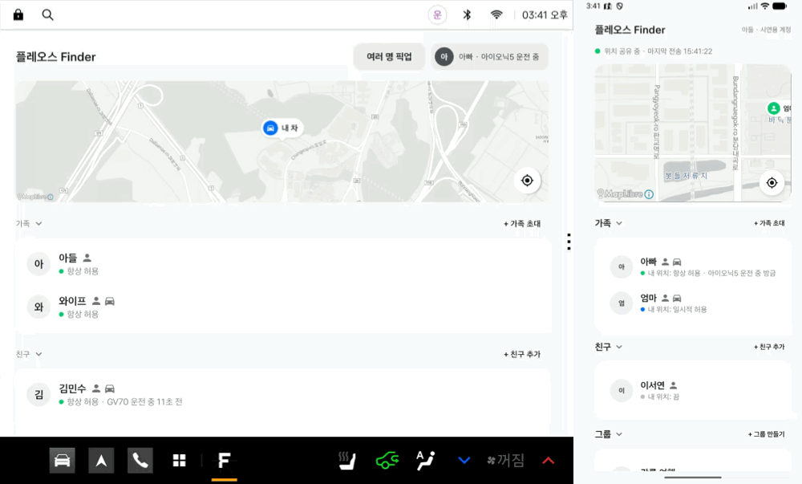

원본 영상: [차량 demo-vehicle.mp4](docs/videos/demo-vehicle.mp4) (1280 × 720, 전체 화면) · [폰 demo-phone.mp4](docs/videos/demo-phone.mp4) (540 × 1200)

영상 순서:
1. 차량 메인 화면에서 **아들 → 픽업**: 차량 내비가 아들 위치로 안내를 시작하고, Finder에 남은 거리·시간이 표시됩니다. 폰에는 "아빠가 오고 있어요"가 뜹니다.
2. **여러 명 픽업**: 김민수 → 와이프 → 아들 순서로 고르고 최종 목적지를 **우리 집**으로 정하면, 경유지를 포함한 경로로 안내가 시작됩니다.
3. 실제 도로 이동시간으로 순서를 비교해 **더 빠른 순서 추천** 팝업이 뜹니다(와이프 → 아들 → 김민수).
4. **[추천 순서로 변경]**: 내비 경로가 다시 잡히고, 폰의 아들 화면이 "3명 중 2번째 · 와이프 픽업 후 내 차례"로 바뀝니다.

> 추천을 알려 주는 음성 안내(TextToSpeech)는 에뮬레이터에 음성 합성 엔진이 없어 영상에서는 들리지 않습니다. 실차에서는 차량의 기본 음성 엔진으로 읽어 줍니다.

## 화면

Pleos Connect Emulator(차량)와 Android 폰 에뮬레이터에서 캡처한 화면입니다. 사람·차량 이름은 시연용 데이터입니다.

**시연 무대 (가정):** 발표 장소를 아빠의 회사로 가정합니다. 에뮬레이터의 차량 위치가 고정된 판교 제2테크노밸리(성남 수정구 시흥동)에서 아빠가 퇴근하며 **판교역의 아들**을 태우고 **집(판교원마을 5단지)**으로 갑니다. 엄마는 판교역 북쪽 봇들마을, 친구 김민수는 정자역, 직장 동료 박지훈은 서현역 근처에 있습니다. 주말에는 '강릉 여행' 그룹으로 집에서 **강릉 경포해변**까지 함께 갑니다.

### 차량 앱 (주행 중에는 안전상 일부 기능 제한, 글레오 AI로 핸즈프리 컨트롤)

| 회사(판교 제2테크노밸리)에서 본 가족·친구·그룹과 지도 | 판교역의 아들에게 가는 중 (3.3km · 11분) |
|---|---|
| 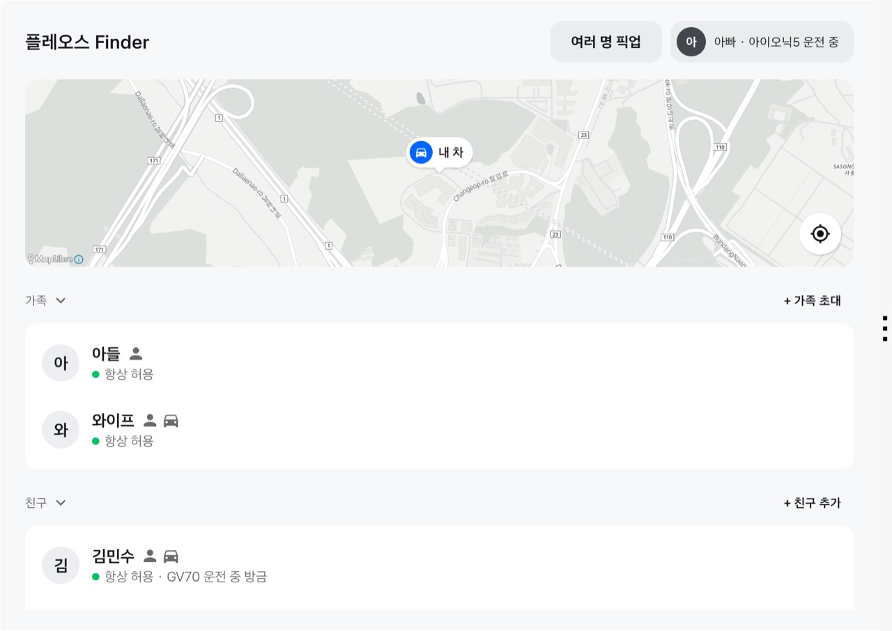 | 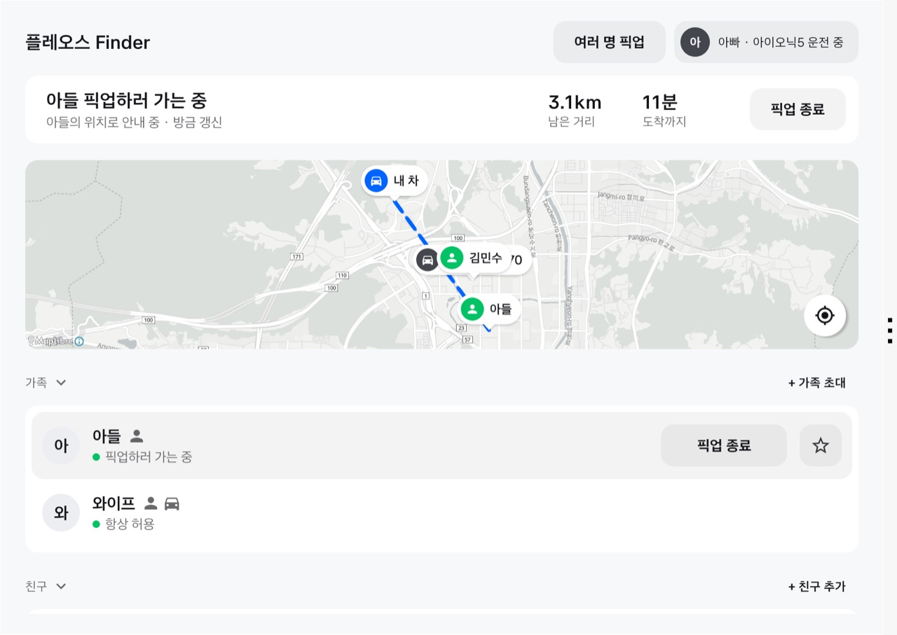 |
| **여러 명 픽업: 태울 순서대로 선택** | **여러 명 픽업 진행 (와이프 → 아들 → 김민수 → 우리 집)** |
| 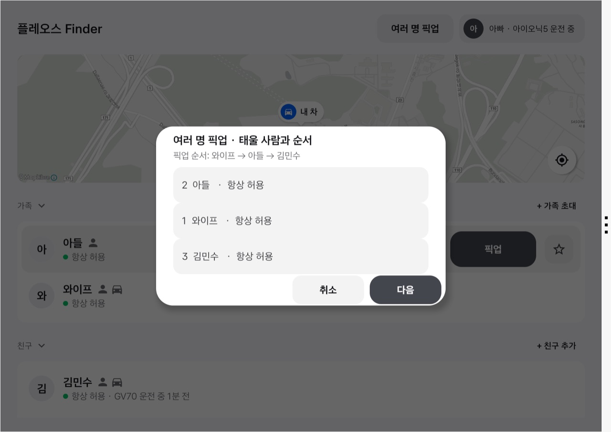 | 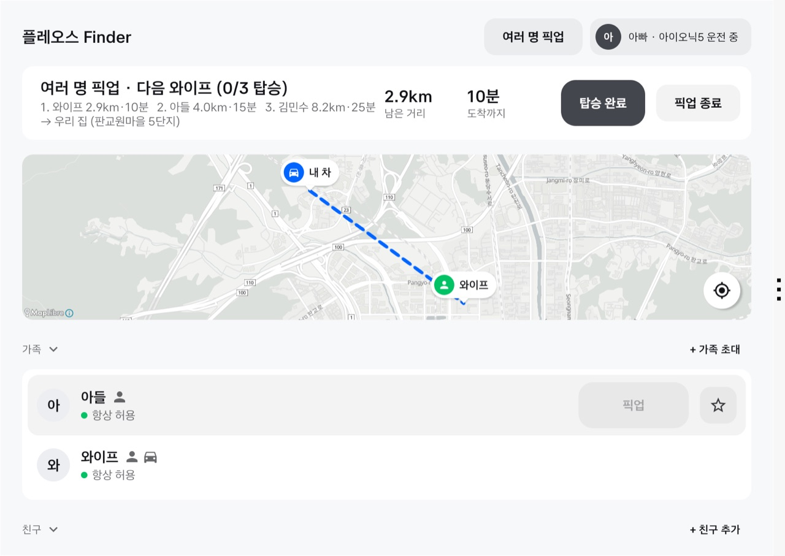 |
| **더 빠른 순서 추천: 김민수 → 와이프 → 아들(약 22분)보다 와이프 → 아들 → 김민수(약 20분)** | **[추천 순서로 변경] 후: 내비 경로와 각자의 차례가 바뀜** |
| 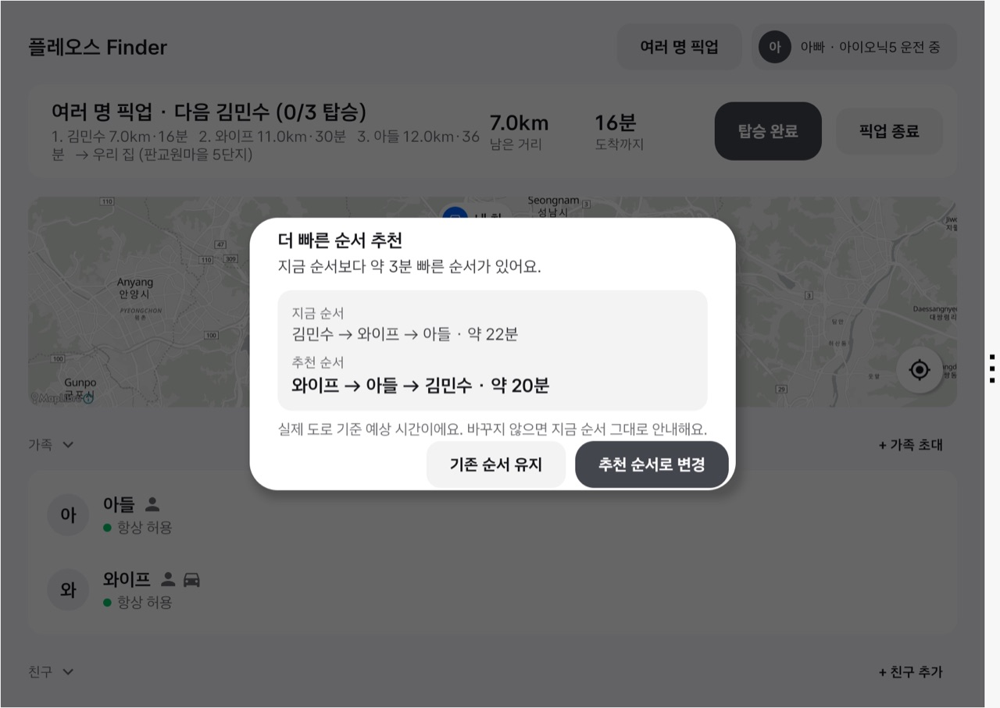 | 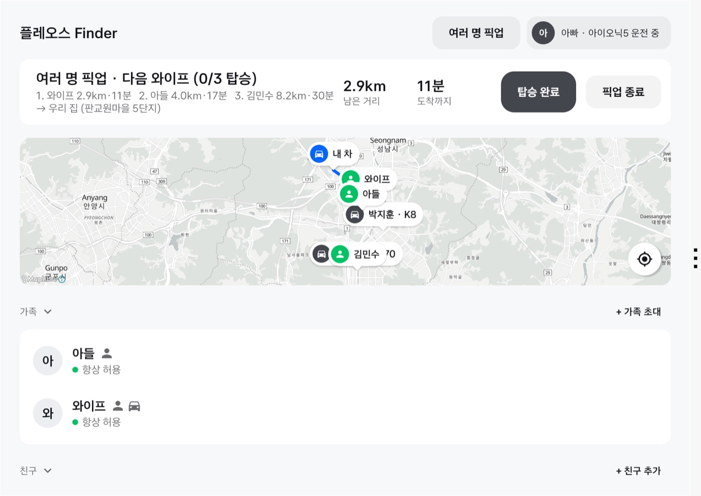 |
| **강릉 여행 그룹에 강릉 경포해변 공유, 차량별 도착 예정** | **운전 중 화면 제한 (D단 주행 중 안내)** |
| 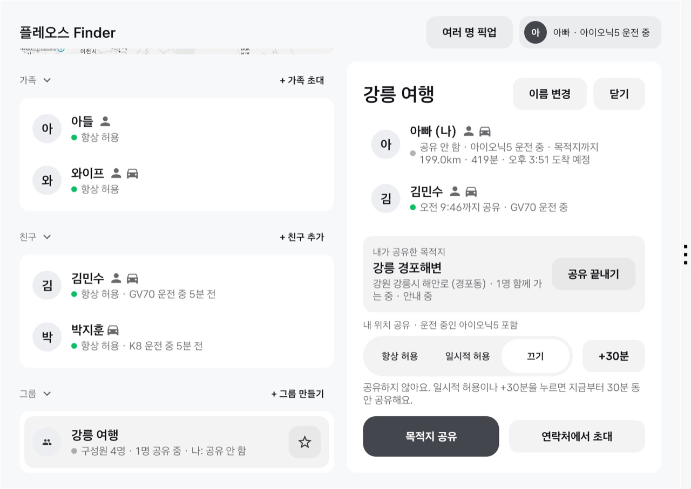 | 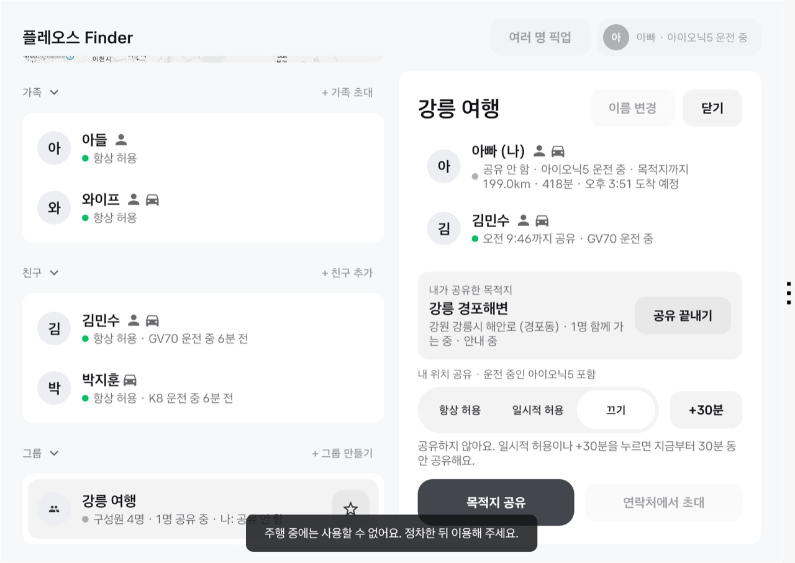 |

### 차량끼리 (아빠 아이오닉5 ↔ 김민수 GV70)

차량 에뮬레이터 한 대에서 프로필 → **다른 차량으로 시연**으로 차량을 바꿔 가며 캡처했습니다.

| 아빠 차: 김민수와 차량 위치 공유 시간 설정 (30분 단위) | 아빠 차: 서로 공유 중 (~오전 10:56) |
|---|---|
| 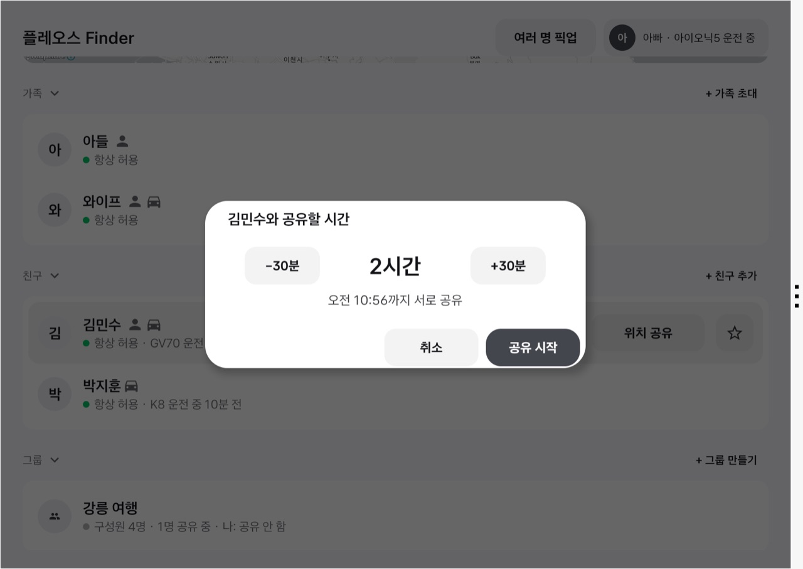 | 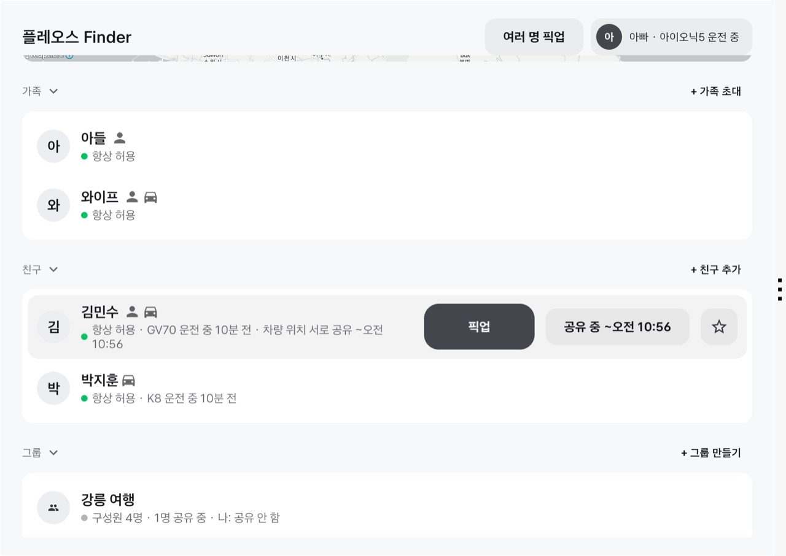 |
| **김민수 GV70: 아빠가 공유한 강릉 목적지 팝업, 아빠 아이오닉5 위치 공유 중** | **김민수 GV70: 안내 시작 후 지도에 강릉 경포해변 깃발과 남은 시간** |
| 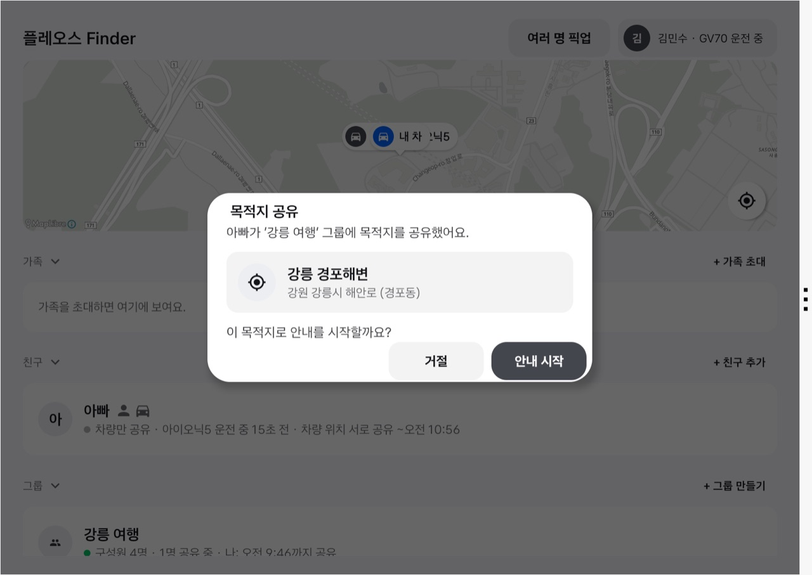 | 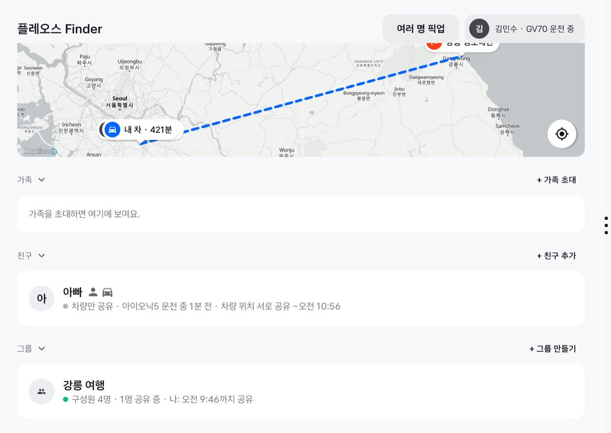 |

> **강릉까지 약 7시간(419~421분)으로 보이는 이유:** 사진의 남은 거리·시간·도착 예정은 Finder가 정한 값이 아니라 **Pleos Connect Emulator의 기본 내비게이션이 계산해 알려 준 값**을 그대로 보여 준 것입니다(NaviHelper `onDrivingInfo`). 에뮬레이터의 경로 탐색은 실제 교통 정보와 다르게 계산되어, 판교 → 강릉 경포해변(약 199km, 실제로는 약 2시간 30분 안팎)이 약 7시간으로 나옵니다. 실차에서는 차량 내비가 실시간 교통으로 계산한 값이 그대로 표시됩니다. 같은 이유로 에뮬레이터 차량은 회사 위치에 고정되어 실제로 이동하지 않습니다.

### 폰 앱 (아들)

| 판교역에서 기다리는 아들의 픽업 현황 | 여러 명 픽업: 3명 중 2번째, 예상 픽업 시각 | 강릉 경포해변 목적지 공유 받기 | 강릉 여행 그룹: 아빠 차 도착 예정 |
|---|---|---|---|
| 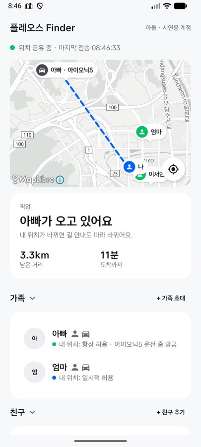 | 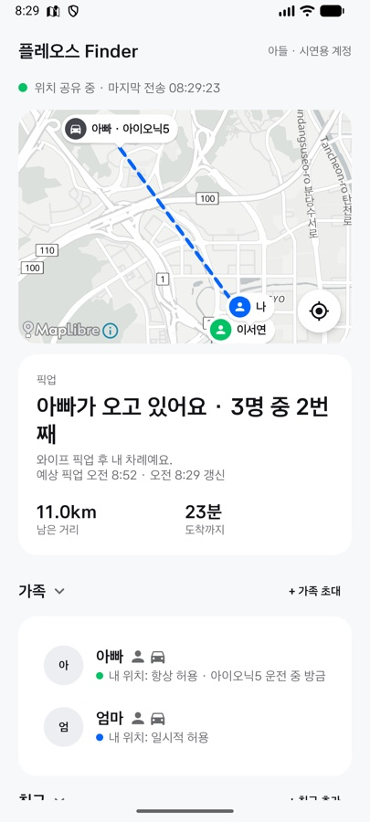 | 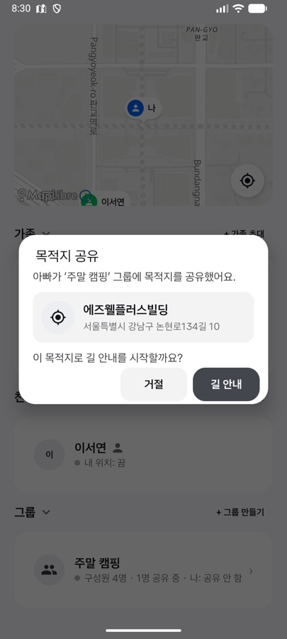 | 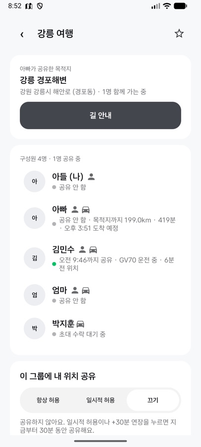 |

## APK

| 파일 | 설치 대상 | 역할 |
|---|---|---|
| [`apk/EOKYEONGBIN_PleosFinder_release.apk`](apk/EOKYEONGBIN_PleosFinder_release.apk) | Pleos Connect Emulator | 차량 앱 (심사 대상) |
| [`apk/EOKYEONGBIN_PleosFinderPhone_release.apk`](apk/EOKYEONGBIN_PleosFinderPhone_release.apk) | Android 폰 또는 폰 에뮬레이터 | 픽업 대상(가족)이 쓰는 폰 앱 |

두 APK 모두 release 빌드이며, 같은 Firebase 서버에 연결되어 있어 설치만 하면 바로 서로 통신합니다.

## 현재 구현된 기능 (1차 접수 기준)

| 기능 | 차량 앱 | 폰 앱 |
|---|---|---|
| 운전자(계정) 전환: 오른쪽 위 프로필에서 아빠 ↔ 엄마 | ○ | - |
| 가족·친구·그룹 패널, 이름 옆 사람·차량 아이콘 | ○ | ○ |
| 항목을 누르면 펼쳐지는 '픽업'(사람) / '위치 공유'(차량) 버튼 | ○ | - |
| 차량끼리 위치 공유: 오늘 하루만 또는 30분 단위 최대 24시간 | ○ | - |
| 화면: 기본 한 칸, 그룹을 열면 두 칸, 픽업 중에만 맨 위 픽업 줄 | ○ | - |
| 연락처에서 가족·친구 초대, 받은 초대 수락·거절 | ○ | ○ |
| 상대별 위치 공유 허용: 항상 허용 / 일시적 허용 / 끄기 | ○ (상태 표시) | ○ (사람을 누르면 아래에서 선택) |
| 픽업: 항상 허용이면 바로 길 안내, 일시적 허용이면 폰에 공유 요청 | ○ | ○ |
| 구성원이 움직이면 목적지 자동 갱신, 차 50m 안이면 자동 완료 | ○ | ○ (도착 알림) |
| 그룹 만들기·연락처 초대, 그룹별 공유(일시적 = 30분 단위 +30분) | ○ | ○ (초대 참여, 그룹 상세, 그룹별 공유) |
| 그룹 이름 변경(그룹을 만든 사람) | ○ | ○ |
| 지도: 나에게 공유된 사람·차량 마커, 픽업 중 차와 상대를 잇는 선 | ○ | ○ |
| 지도: 처음에는 내 위치를 가깝게, 오른쪽 아래 내 위치 보기 버튼, 목록에서 두 번 누르면 그 사람 위치로 확대 | ○ | ○ |
| 즐겨찾기(별): 즐겨찾기한 사람·그룹이 패널 맨 위에 표시 | ○ | ○ |
| 그룹 목적지 공유: 지금 안내 중·최근 목적지·내 차 위치를 그룹에 공유, 받은 사람은 팝업·알림에서 수락하면 차량은 내비, 폰은 지도 앱으로 길 안내 | ○ (공유·수락) | ○ (수락) |
| 그룹 패널에서 같은 목적지로 가는 차량별 남은 거리·시간·도착 예정 시각 | ○ | ○ |
| Finder 지도에 그룹 목적지 깃발, 내 위치와 목적지를 잇는 점선, 차량 마커에 남은 시간(예: 김민수 · GV70 · 12분) | ○ | ○ |
| 패널 제목을 눌러 접기·펼치기, 패널마다 4줄까지 보이고 나머지는 더 보기 | ○ | ○ |
| 차량 위치는 지금 운전하는 사람의 설정으로만 공유 | ○ | ○ (운전 중인 가족·친구 줄에 차량 표시) |
| 운전 중 화면 제한: 주행 중(D단)에는 초대·그룹 만들기·이름 변경·운전자 전환을 막고 버튼을 흐리게, 누르면 "정차한 뒤 이용해 주세요" 안내 | ○ | - |
| Gleo AI 음성 명령: 픽업(한 명·여러 명, 더 빠른 순서 음성 추천과 "바꿔줘"/"그대로 가자"), 사람·그룹에 시간 제한 위치 공유, 그룹 목적지 공유("지금 목적지 공유해줘", "여기로 모이자고 해줘"), 공유 끄기 | ○ | - |
| 스마트 멀티 픽업 1단계: 여러 명을 태울 순서대로 선택·특정 인원 먼저 고정·최종 목적지 → 고른 순서 그대로 내비 경유지 안내, [탑승 완료]·50m 도착으로 다음 사람 | ○ | ○ (N명 중 M번째, 앞사람, 본인 차례까지 경로상 km·분·예상 픽업 시각) |

| 스마트 멀티 픽업 2단계: 모두의 위치가 오면 실제 도로 이동시간으로 순서를 비교해 **2분 이상 빠른 순서가 있을 때만 선택적으로 추천**(고정한 사람은 항상 맨 앞), [추천 순서로 변경]을 누를 때만 적용하고 [기존 순서 유지]·닫기는 고른 순서 그대로 | ○ | ○ (바뀐 차례 표시) |
| 스마트 멀티 픽업 3단계: Gleo로 "와이프랑 아들 태우고 집에 가자" → 고른 순서로 안내를 시작하고, 더 빠른 순서가 있으면 Gleo가 "와이프를 먼저 태우면 약 3분 빠릅니다. 순서를 바꿀까요?"라고 되묻기 → "바꿔줘"면 변경, "그대로 가자"면 유지 | ○ | - |

순서 추천은 학습형 AI가 아니라, 출발지(차)와 최종 목적지를 고정하고 가능한 방문 순서를 모두 비교하는 방식입니다(6명까지, 최대 720가지). 사람과 사람 사이의 이동시간은 NaviHelper로 얻을 수 없어 **시연용으로 OSRM 공개 서버(OpenStreetMap 도로망)의 이동시간 표**를 씁니다. 이때 차·픽업 대상·목적지 좌표가 외부 서버로 전송되며, 상용화 때는 Pleos 제공 API나 계약한 경로 API로 바꿀 계획입니다([기획서](docs/기획서.md) 5장). 추천 계산에 실패하면 추천 없이 고른 순서 그대로 안내합니다.

호칭은 보는 사람 기준입니다(아빠에게 엄마는 '와이프', 엄마에게 아빠는 '남편'). 계정은 기획상 Pleos 계정으로 로그인하지만, 출품본은 차량 앱 = 아빠 또는 엄마(프로필에서 전환), 폰 앱 = 아들로 로그인되어 있다고 가정합니다. 연락처는 시연용 고정 목록(아빠, 엄마, 아들, 친구 김민수, 직장 동료 박지훈, 친구 이서연)입니다. 차량 무전은 2차 PT 심사 전까지 구현할 예정입니다.

## Gleo AI 음성 연동

차량 앱은 `app/src/main/assets/schema.json`으로 기능 3개(Gleo 최대 개수)를 등록합니다. Pleos Connect Emulator의 Gleo AI가 설치 즉시 이 파일을 읽는 것을 로그로 확인했습니다(`functionCount=3`).

| 기능 | 예시 발화 | 동작 |
|---|---|---|
| `PICKUP(action, memberName)` | "와이프 픽업 가줘", "픽업 그만할래", "아들 지금 어디쯤이야?" | 한 명 픽업 시작·종료, 남은 거리·시간 답변 |
| `PICKUP` 여러 명 (`memberNames`, `pinnedName`, `destinationName`, `action`=`accept_order`/`keep_order`) | "와이프랑 아들 태우고 집에 가자", "응 바꿔줘", "그대로 가자" | 말한 순서로 여러 명 픽업 시작, 더 빠른 순서가 있으면 음성으로 추천하고 되묻기, 답에 따라 변경·유지 |
| `SHARE_LOCATION(targetName, shareType, durationMinutes, untilEndOfToday)` | "박지훈한테 1시간만 위치 공유해줘", "강릉 여행 그룹에 2시간만 공유해줘", "강릉 여행 그룹에 지금 목적지 공유해줘", "강릉 여행 그룹에 여기로 모이자고 해줘" | 사람이면 차량끼리 서로 공유, 그룹이면 그룹에 일시적 공유(30분 단위, 최대 24시간). shareType이 current_destination이면 지금 내비 목적지를, car_position이면 지금 내 차 위치(모이는 곳)를 그룹에 목적지로 공유 |
| `STOP_LOCATION_SHARING(targetName, category)` | "친구 목록 중에 위치 공유된 것 모두 꺼줘" | 한 사람·그룹, 또는 가족·친구·그룹·전체에서 내가 켠 공유를 끔 |

- 세 기능 모두 화면 없이 처리하는 `service` 방식입니다(`gleo/GleoActionReceiver.kt`). Pleos 문서 예시는 인텐트 action이 함수 이름(`PICKUP`)이지만, 에뮬레이터의 Gleo AI(ambientai 4.2)는 `com.EOKYEONGBIN.pleosfinder.PICKUP`처럼 패키지 이름을 붙여 보내므로 두 형식을 모두 받습니다. 결과는 Gleo Callback 규격(`success` / `asking` / `fail`)으로 7초 안에 돌려줍니다.
- 이름은 운전자가 부르는 호칭(와이프·남편·아들)과 계정 이름으로 찾고, 모르는 이름이나 빠진 시간은 `asking`으로 되묻습니다.
- 설치 직후에는 Android가 앱을 '중지됨' 상태로 두어 Gleo 호출을 받지 못하므로, 차량 앱을 한 번 열어 주세요.
- 음성 없이 시험하려면 Gleo가 보내는 것과 같은 신호를 보냅니다.
  ```
  adb -s <Pleos 에뮬레이터> shell am broadcast --user current -p com.EOKYEONGBIN.pleosfinder -a com.EOKYEONGBIN.pleosfinder.PICKUP --es ACTION_PARAM '{"action":"start","memberName":"와이프"}'
  adb -s <Pleos 에뮬레이터> shell am broadcast --user current -p com.EOKYEONGBIN.pleosfinder -a com.EOKYEONGBIN.pleosfinder.SHARE_LOCATION --es ACTION_PARAM '{"targetName":"강릉 여행","durationMinutes":120}'
  ```

## 디자인

- [Pleos Connect 디자인 시스템](https://document.pleos.ai/en/docs/connect/guide/docs-design/Introduction/intro)의 색상 토큰(주간·야간), 글꼴(Asta Sans), 버튼·세그먼트·토스트 규격을 `core/src/main/res`에 옮겨 두 앱이 함께 씁니다.
- 차량 앱은 운전 중에도 쓰는 화면이라 `distractionOptimized`로 등록했습니다. 주행(D단) 중에도 화면이 가려지지 않는 것을 에뮬레이터에서 확인했습니다.
- 폰 앱에 넣은 Asta Sans 글꼴은 SIL Open Font License 1.1을 따릅니다. 라이선스 전문은 `phone/src/main/assets/licenses/AstaSans-OFL.txt`에 있습니다.
- 차량·폰 앱 지도는 MapLibre Native(BSD 2-Clause)와 OpenFreeMap 지도를 씁니다. 지도 자료는 © OpenStreetMap contributors이며, 지도 화면의 ⓘ 버튼에 출처가 표시됩니다.

## 테스트 환경

| 항목 | 버전 |
|---|---|
| 차량 | Pleos Connect Emulator v2.1.0 (Android 14, API 34, arm64), 화면 2560 × 1440 · 160dpi (Finder는 오른쪽 앱 영역에 표시) |
| 폰 | Android Emulator, Medium Phone API 37 (Google Play), 화면 1080 × 2400 |
| 개발 도구 | Android Studio 2026.2.1, Kotlin, Android Gradle Plugin 9.4.1 |
| Pleos SDK | NaviHelper 3.0.5 |
| 서버 | Firebase Realtime Database (asia-southeast1) |

필요한 설정:

- 두 에뮬레이터 모두 인터넷에 연결되어 있어야 합니다.
- 폰 앱 첫 실행 시 위치 권한과 알림 권한을 허용해야 합니다.
- 에뮬레이터에서 폰 위치는 Extended Controls(⋯) → Location 에서 지정합니다.

## 실행 방법 (가족 픽업 시나리오)

1. Pleos Connect Emulator 에 차량 앱을 설치합니다.
   ```
   adb -s <Pleos 에뮬레이터> install apk/EOKYEONGBIN_PleosFinder_release.apk
   ```
2. 폰 에뮬레이터에 폰 앱을 설치합니다.
   ```
   adb -s <폰 에뮬레이터> install apk/EOKYEONGBIN_PleosFinderPhone_release.apk
   ```
3. 차량 앱 오른쪽 위 프로필 → **시연 데이터 초기화**를 누릅니다. 가족(와이프·아들), 친구(김민수: 사람+차량, 박지훈: 차량만), 그룹(강릉 여행)이 준비됩니다. 아빠 차는 회사(판교 제2테크노밸리)에 있습니다.
4. 폰 에뮬레이터의 위치를 **판교역(위도 37.39437, 경도 127.11115)**으로 지정합니다(Extended Controls(⋯) → Location, 또는 `adb -s <폰 에뮬레이터> emu geo fix 127.11115 37.39437`). 폰 앱(Finder, 아들로 로그인)을 열고 위치·알림 권한을 허용합니다. 차량 앱과 같이 가족(아빠·엄마), 친구(이서연), 그룹(강릉 여행 초대: 참여·거절) 패널이 보입니다. 사람을 누르면 그 사람에게 내 위치를 항상 허용 / 일시적 허용 / 끄기 중 무엇으로 줄지 고릅니다. 시연 데이터는 아빠에게 항상 허용, 엄마에게 일시적 허용입니다.
5. 차량 앱에서 **아들**을 누르면 오른쪽에 **픽업** 버튼이 나옵니다. 누르면 바로 픽업이 시작됩니다.
   - 아빠에게는 항상 허용이므로 차량 내비게이션이 곧바로 아들의 위치로 길 안내를 시작하고, 폰에는 "아빠가 오고 있어요"와 남은 거리·시간이 나옵니다.
6. 프로필에서 **엄마(으)로 전환**한 뒤 **아들 → 픽업**을 누르면, 엄마에게는 일시적 허용이므로 폰에 "엄마가 픽업하러 가려고 해요" 알림이 뜹니다. **공유하기**를 누르면 길 안내가 시작됩니다.
   - 폰 위치를 바꾸면 경로가 갱신되고, 차량 위치 근처(회사, 위도 37.41275, 경도 127.09470)로 옮기면 픽업이 자동 완료됩니다.
7. 친구 패널에서 **김민수**를 누르면 **픽업**과 **위치 공유**가, **박지훈**(차량만)을 누르면 **위치 공유**가 나옵니다. 위치 공유는 **오늘 하루만 공유** 또는 **시간 설정**(−30분 / +30분, 최대 24시간)으로 정한 시간 동안만 서로 차량 위치를 공유합니다.
8. 그룹 패널의 **강릉 여행**을 누르면 화면이 두 칸으로 나뉘며 오른쪽에 구성원과 내 공유 설정이 나옵니다(닫기를 누르면 한 칸으로 돌아옴). **+30분**을 누를 때마다 공유 시간이 30분씩 늘어납니다. **목적지 공유** → **저장한 장소 · 강릉 경포해변**을 고르면 아빠 차는 강릉으로 안내를 시작하고, 그룹 구성원에게 "목적지 공유" 팝업이 갑니다.
   - 여러 명 픽업은 오른쪽 위 **여러 명 픽업**에서 태울 순서대로 고르고(필요하면 한 명 먼저 고정) 최종 목적지로 **저장한 장소 · 우리 집**을 고릅니다. 예를 들어 **김민수 → 와이프 → 아들** 순서로 고르면 고른 순서로 안내가 시작되고, 잠시 뒤 "더 빠른 순서 추천" 팝업(와이프 → 아들 → 김민수, 약 3분 빠름)이 뜹니다. **추천 순서로 변경**을 누르면 경로와 각자의 차례가 바뀌고, **기존 순서 유지**를 누르면 그대로 갑니다. 아들 폰에는 "3명 중 N번째"와 예상 픽업 시각이 보이며, 차량의 **탑승 완료**로 다음 사람으로 넘어갑니다.
9. 엄마로 전환하면 목록이 엄마 기준으로 바뀌고, 아이오닉5의 위치는 엄마의 설정으로만 공유됩니다(아빠 그룹에는 보이지 않음).

> Pleos Connect Emulator 의 기본 내비게이션은 지도 바탕(도로·건물)을 그리지 않는 빈 스타일(`connect_empty`)을 사용합니다. 경로선, 회전 안내, 남은 거리·시간은 정상 표시됩니다.
>
> 에뮬레이터의 차량 위치는 고정(성남시 수정구 시흥동)이라 차가 경로를 따라 이동하지 않습니다. 그래서 시연에서는 구성원이 차 쪽으로 이동하는 방식으로 도착을 보여 줍니다. 실차에서는 내비게이션의 목적지 도착 이벤트로도 픽업이 완료됩니다.

## 프로젝트 구조

```
app/    차량 앱 (Pleos Connect). 앱 전체 상태: VehicleSession.kt, Gleo 음성 명령: gleo/,
        허용 방식별 픽업 시작: pickup/PickupRequester.kt, 한 명 길 안내·도착: pickup/PickupController.kt,
        여러 명 픽업(경유지 안내): pickup/MultiPickupController.kt, 순서 추천: pickup/RouteRecommender.kt,
        운전 중 화면 제한: DrivingRestriction.kt, 목적지 공유 알림: DestinationNotifier.kt, 음성 안내: VoiceGuide.kt
phone/  폰 앱. 허용 방식에 따른 위치 공유·요청 알림: LocationShareService.kt, 그룹 화면: GroupActivity.kt
core/   두 앱이 함께 쓰는 데이터 모델·시연 데이터·Firebase 연동(FirebaseFinderRepository.kt), 공용 지도(ui/FinderMap.kt)
docs/   기획서, 화면 캡처(images/)
apk/    제출용 release APK
```

서버 데이터 구조 (구성원별 최신 값만 저장하고 이동 기록은 남기지 않습니다):

```
groups/{groupId}/locations/{memberId}                    위도, 경도, 갱신 시각
groups/{groupId}/vehicleLocations/{vehicleId}            위도, 경도, 지금 운전자, 갱신 시각
groups/{groupId}/connections/{ownerId}/{otherId}         관계(가족·친구), 초대 상태
groups/{groupId}/permissions/{ownerId}/{viewerId}        항상 허용 / 일시적 허용 / 끄기
groups/{groupId}/vehicleShares/{ownerId}/{viewerId}      차량끼리 공유 끝나는 시각
groups/{groupId}/shareRequests/{ownerId}                 요청한 사람, 상태(대기·수락·거절·종료)
groups/{groupId}/pickups/{memberId}                      운전자, 상태, 남은 거리·시간, 차량 위치, 내 차례·전체 인원·앞사람, 갱신 시각
groups/{groupId}/finderGroups/{groupId}                  그룹 이름, 만든 사람, 구성원별 초대 상태·공유 설정
groups/{groupId}/destinationShares/{groupId}/{shareId}   공유한 목적지, 구성원별 수락, 차량별 남은 거리·시간
```

## 소스에서 빌드하기

보안을 위해 Firebase 설정 파일과 서명 키는 저장소에 포함하지 않았습니다. 소스로 직접 빌드하려면:

1. 본인 Firebase 프로젝트에서 Realtime Database 를 만들고, Android 앱 두 개(`com.EOKYEONGBIN.pleosfinder`, `com.EOKYEONGBIN.pleosfinder.phone`)를 등록합니다.
2. 내려받은 `google-services.json` 을 `app/` 과 `phone/` 에 각각 넣습니다.
3. `core/src/main/java/com/EOKYEONGBIN/pleosfinder/core/FirebaseFinderRepository.kt` 의 `DATABASE_URL` 을 본인 데이터베이스 주소로 바꿉니다.
4. 디버그 빌드: `./gradlew :app:assembleDebug :phone:assembleDebug`

## 직접 시연해 보기 (심사용 시나리오)

설치부터 주요 기능 확인까지 약 15분 걸립니다. 단계마다 **확인할 점**을 적어 두었습니다. 위 [시연 영상](#시연-영상)의 1~3번과 같은 흐름입니다.

### 0. 준비 (약 5분)

1. **에뮬레이터 두 대를 띄웁니다.** Pleos Connect Emulator(차량)와 Android 폰 에뮬레이터(예: Medium Phone, API 34 이상)입니다. 두 대 모두 인터넷에 연결되어 있어야 합니다.
2. **APK를 설치합니다.**
   ```
   adb devices                     # 예: emulator-5554 = 차량, emulator-5556 = 폰
   adb -s <차량> install apk/EOKYEONGBIN_PleosFinder_release.apk
   adb -s <폰>   install apk/EOKYEONGBIN_PleosFinderPhone_release.apk
   ```
3. **폰 위치를 판교역으로 지정합니다.** `adb -s <폰> emu geo fix 127.11115 37.39437` 또는 폰 에뮬레이터 Extended Controls(⋯) → Location에서 위도 37.39437, 경도 127.11115를 지정합니다.
4. **폰 앱(Finder)을 열고** 위치 권한(앱 사용 중 허용)과 알림 권한을 허용합니다. 폰 앱은 '아들' 계정입니다.
5. **차량 앱(Finder)을 엽니다.** 앱 목록 또는 아래 독의 **F** 아이콘입니다. 오른쪽 위 프로필(아빠 · 아이오닉5 운전 중) → **시연 데이터 초기화**를 누르면 가족·친구·그룹이 처음 상태로 돌아갑니다. 시나리오를 다시 할 때마다 초기화하면 됩니다.

> 차량 위치는 에뮬레이터에 고정되어 있습니다(판교 제2테크노밸리, 아빠의 회사로 가정). 픽업 길 안내가 시작되면 화면이 차량 내비로 바뀌는데, 아래 독의 **F** 아이콘을 누르면 Finder로 돌아옵니다.

### 1. 아들 한 명 픽업 (항상 허용)

1. 차량 앱 가족 패널에서 **아들**을 누르고, 오른쪽에 나온 **픽업**을 누릅니다.
2. 차량 내비가 아들 위치(판교역)로 경로를 잡고 안내를 시작합니다. **F**로 Finder에 돌아옵니다.

확인할 점:
- 차량: 맨 위에 "아들 픽업하러 가는 중"과 남은 거리·시간이 보이고, 지도에 내 차와 아들을 잇는 선이 그려집니다.
- 폰: "아빠가 오고 있어요"와 남은 거리·시간이 보입니다.
- 자동 완료(선택): `adb -s <폰> emu geo fix 127.09470 37.41275`로 아들을 차 근처로 옮기면 픽업이 자동으로 끝나고 폰에 도착 알림이 옵니다. 다시 하려면 폰 위치를 판교역으로 되돌립니다.
3. 맨 위 **픽업 종료**를 누르고 **F**로 돌아옵니다.

### 2. 일시적 허용 → 폰에서 수락 (엄마 운전)

1. 프로필 → **엄마로 전환**을 누릅니다. 엄마에게 아들의 위치는 '일시적 허용'입니다.
2. **아들 → 픽업**을 누릅니다.

확인할 점:
- 폰에 "엄마가 픽업하러 가려고 해요" 알림이 뜹니다. **공유하기**를 누르면 그때부터 차량 길 안내가 시작됩니다. 수락 전에는 아들의 위치를 쓰지 않습니다.
3. **픽업 종료**를 누르고, 프로필 → **아빠로 전환**합니다.

### 3. 여러 명 픽업과 더 빠른 순서 추천 (스마트 멀티 픽업)

1. 오른쪽 위 **여러 명 픽업**을 누릅니다.
2. 태울 순서대로 **김민수 → 와이프 → 아들**을 누릅니다. 이름 앞에 순서 번호가 붙습니다. **다음**을 누릅니다.
3. '반드시 먼저 픽업할 사람'은 **고정 안 함**을 그대로 두고 **다음**을 누릅니다. 한 명을 고정하면 그 사람은 추천 순서에서도 항상 맨 앞입니다.
4. 최종 목적지로 **저장한 장소 · 우리 집 (판교원마을 5단지)**을 고릅니다.
5. 차량 내비가 경유지를 포함한 경로로 안내를 시작합니다. **F**로 Finder에 돌아옵니다.

확인할 점:
- 맨 위에 "여러 명 픽업 · 다음 김민수 (0/3 탑승)"과 사람별 거리·시간, 최종 목적지가 보입니다.
- 잠시 뒤 **더 빠른 순서 추천** 팝업이 뜹니다. 지금 순서(김민수 → 와이프 → 아들, 약 22분)보다 와이프 → 아들 → 김민수(약 19분)가 빠르다고 알려 줍니다. 시간은 실제 도로 이동시간으로 계산하므로 조금 다를 수 있고, 2분 이상 빠를 때만 추천합니다.
6. **추천 순서로 변경**을 누릅니다.

확인할 점:
- 차량 내비 경로가 와이프 → 아들 → 김민수 순서로 다시 잡히고, 맨 위가 "다음 와이프"로 바뀝니다.
- 폰(아들): "아빠가 오고 있어요 · 3명 중 2번째", "와이프 픽업 후 내 차례예요", 예상 픽업 시각이 보입니다.
- **탑승 완료**를 누를 때마다 다음 사람으로 넘어가고, 폰의 차례도 바뀝니다.
7. **픽업 종료**를 누릅니다. **기존 순서 유지**를 누르면 처음 고른 순서 그대로 가는 것도 확인할 수 있습니다.

> 추천 팝업과 함께 나오는 음성 안내는 에뮬레이터에 음성 합성 엔진이 없어 들리지 않습니다. 순서 추천에는 OSRM 공개 서버(인터넷)를 쓰며, 계산에 실패하면 추천 없이 고른 순서대로 안내합니다.

### 4. 그룹 목적지 공유 (강릉 여행)

1. 폰 앱 그룹 패널의 **강릉 여행** 초대에서 **참여**를 누릅니다.
2. 차량 앱 그룹 패널에서 **강릉 여행**을 누르면 화면이 두 칸으로 나뉩니다. **목적지 공유** → **저장한 장소 · 강릉 경포해변**을 고릅니다.

확인할 점:
- 아빠 차 내비가 강릉 경포해변으로 안내를 시작합니다. Finder 지도에 목적지 깃발이 표시되고, 그룹 패널에 차량별 남은 거리·시간·도착 예정 시각이 보입니다.
- 폰에 "목적지 공유" 팝업이 뜹니다. 수락하면 폰의 지도 앱으로 길 안내가 열립니다.
- 에뮬레이터 내비가 계산하는 강릉까지의 시간은 실제(약 2시간 30분)보다 길게(약 7시간) 나옵니다. [위 설명](#차량끼리-아빠-아이오닉5--김민수-gv70)을 참고해 주세요.

### 5. 차량끼리 위치·목적지 공유 (아빠 아이오닉5 ↔ 김민수 GV70)

차량 에뮬레이터 한 대로 차량을 바꿔 가며 확인합니다. 차량 에뮬레이터가 두 대라면 각각 다른 차량을 고르면 됩니다.

1. 아빠 차에서 친구 패널의 **김민수 → 위치 공유**를 누르고 **오늘 하루만 공유** 또는 **시간 설정**(30분 단위)으로 공유합니다.
2. 4번처럼 강릉 여행 그룹에 강릉 경포해변을 공유한 상태에서, 프로필 → **다른 차량으로 시연** → **GV70 · 김민수**를 고릅니다.

확인할 점:
- 김민수 GV70 화면에 아빠가 공유한 강릉 목적지 팝업이 뜹니다. **안내 시작**을 누르면 GV70 내비도 강릉으로 안내합니다.
- 김민수 쪽 목록에서 아빠 아이오닉5의 위치가 공유 중으로 보입니다.
3. 프로필 → **다른 차량으로 시연** → **아이오닉5 · 아빠**로 돌아옵니다.

### 6. 주행 중 화면 제한

1. Pleos Connect Emulator의 Virtual Console(차량 신호 조작)에서 기어를 **D**로 바꾸고 속도를 올립니다.

확인할 점:
- 프로필(운전자 전환), 여러 명 픽업, 가족 초대·친구 추가·그룹 만들기, 그룹 이름 변경·초대 버튼이 흐려집니다. 누르면 "주행 중에는 사용할 수 없어요. 정차한 뒤 이용해 주세요."라고 안내합니다.
- 진행 중인 픽업 정보와 지도는 그대로 보이고, 아래 7번의 Gleo 음성 명령은 주행 중에도 쓸 수 있습니다.
2. 기어를 **P**로 돌리면 다시 모든 버튼을 쓸 수 있습니다.

### 7. Gleo AI 음성 명령 (핸즈프리)

차량 앱을 한 번 연 뒤 Gleo에게 말합니다. 예시 발화와 동작은 [Gleo AI 음성 연동](#gleo-ai-음성-연동)에 정리되어 있습니다.

- "와이프 픽업 가줘" → 와이프에게 길 안내 시작, "픽업 그만할래" → 종료
- "와이프랑 아들 태우고 집에 가자" → 여러 명 픽업 시작, 더 빠른 순서가 있으면 Gleo가 되묻고 "응 바꿔줘" / "그대로 가자"로 답함
- "강릉 여행 그룹에 지금 목적지 공유해줘", "박지훈한테 1시간만 위치 공유해줘", "친구 목록 중에 위치 공유된 것 모두 꺼줘"

마이크를 쓸 수 없으면 Gleo가 보내는 것과 같은 신호로 확인할 수 있습니다.

```
adb -s <차량> shell am broadcast --user current -p com.EOKYEONGBIN.pleosfinder -a com.EOKYEONGBIN.pleosfinder.PICKUP --es ACTION_PARAM '{"action":"start","memberNames":["와이프","아들"],"destinationName":"집"}'
adb -s <차량> shell am broadcast --user current -p com.EOKYEONGBIN.pleosfinder -a com.EOKYEONGBIN.pleosfinder.PICKUP --es ACTION_PARAM '{"action":"accept_order"}'
adb -s <차량> shell am broadcast --user current -p com.EOKYEONGBIN.pleosfinder -a com.EOKYEONGBIN.pleosfinder.PICKUP --es ACTION_PARAM '{"action":"stop"}'
```

### 잘 안 될 때

| 증상 | 확인할 것 |
|---|---|
| 폰 앱에 아빠가 오는 정보가 안 보임 | 폰 앱의 위치·알림 권한, 폰 위치 지정(판교역), 두 에뮬레이터의 인터넷 연결 |
| 픽업을 눌렀는데 Finder 화면이 사라짐 | 차량 내비가 앞으로 나온 것입니다. 아래 독의 **F** 아이콘으로 돌아옵니다. |
| 순서 추천 팝업이 안 뜸 | 최종 목적지를 **우리 집**으로 골랐는지 확인합니다. 지금 순서가 이미 가장 빠르거나 2분 미만 차이면 추천하지 않습니다. |
| 상태가 꼬였을 때 | 프로필 → **시연 데이터 초기화** 후 처음부터 다시 합니다. |
| Gleo가 앱 기능을 못 찾음 | 설치 직후에는 차량 앱을 한 번 열어야 Gleo 호출을 받을 수 있습니다. |
